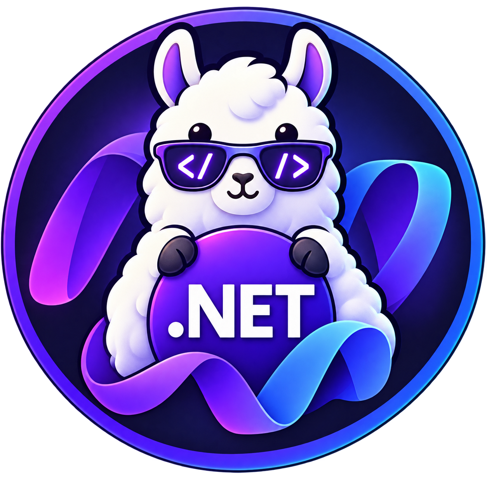

# Ollama .NET Library

Typed C# client for integrating .NET 10+ applications with [Ollama](https://ollama.com).

## Prerequisites

- [.NET 10 SDK](https://dotnet.microsoft.com/download)
- [Ollama](https://ollama.com/download) installed and running
- A model pulled locally:

```sh
ollama pull gemma3
```

See [Ollama Models](https://ollama.com/search) for available models.

## Install

```shell
dotnet add package ollama-dotnet
```

## Basic usage

```csharp
using ollama_dotnet;

using var client = new OllamaClient();

var response = client.Chat(new ChatRequest
{
    Model = "gemma3",
    Messages =
    [
        new Message
        {
            Role = "user",
            Content = "Why is the sky blue?"
        }
    ]
});

Console.WriteLine(response.Message.Content);
```

The default local endpoint is `http://127.0.0.1:11434`.

## Streaming responses

```csharp
foreach (var part in client.ChatStream(new ChatRequest
{
    Model = "gemma3",
    Messages =
    [
        new Message
        {
            Role = "user",
            Content = "Why is the sky blue?"
        }
    ]
}))
{
    Console.Write(part.Message.Content);
}
```

Synchronous streaming methods:

- `GenerateStream`
- `ChatStream`
- `PullStream`
- `PushStream`
- `CreateStream`

## Cloud models

Use cloud models through a local Ollama installation:

```sh
ollama signin
ollama pull gpt-oss:120b-cloud
```

```csharp
foreach (var part in client.ChatStream(new ChatRequest
{
    Model = "gpt-oss:120b-cloud",
    Messages =
    [
        new Message
        {
            Role = "user",
            Content = "Why is the sky blue?"
        }
    ]
}))
{
    Console.Write(part.Message.Content);
}
```

See [Ollama Cloud Models](https://ollama.com/search?c=cloud) for current model names.

## Cloud API

Create an API key at [Ollama.com > Settings > Keys](https://ollama.com/settings/keys), then set it in the environment.

PowerShell:

```powershell
$env:OLLAMA_API_KEY = "your_api_key"
```

Other shells:

```shell
export OLLAMA_API_KEY=your_api_key
```

The client reads `OLLAMA_API_KEY` automatically:

```csharp
using var client = new OllamaClient(host: OllamaConstants.WebApiHost);

var response = client.Chat(new ChatRequest
{
    Model = "gpt-oss:120b",
    Messages =
    [
        new Message { Role = "user", Content = "Why is the sky blue?" }
    ]
});
```

An explicit header can be supplied instead:

```csharp
using var client = new OllamaClient(
    host: OllamaConstants.WebApiHost,
    headers: new Dictionary<string, string>
    {
        ["Authorization"] = "Bearer your_api_key"
    });
```

## Custom client

Pass an existing `HttpClient` when your application owns handlers, proxies, diagnostics, or dependency injection:

```csharp
var httpClient = new HttpClient
{
    BaseAddress = new Uri("http://localhost:11434")
};

using var client = new OllamaClient(httpClient: httpClient);

var response = client.Generate(new GenerateRequest
{
    Model = "gemma3",
    Prompt = "Why is the sky blue?"
});
```

An injected `HttpClient` is not disposed by `OllamaClient`.

```csharp
using var client = new OllamaClient(
    host: "http://localhost:11434",
    followRedirects: true,
    timeout: TimeSpan.FromMinutes(5),
    headers: new Dictionary<string, string>
    {
        ["x-application-name"] = "my-app"
    });
```

## Async client

`AsyncOllamaClient` supports asynchronous calls and cancellation:

```csharp
 using var client = new AsyncOllamaClient();

var response = await client.ChatAsync(
    new ChatRequest
    {
        Model = "gemma3",
        Messages =
        [
            new Message { Role = "user", Content = "Why is the sky blue?" }
        ]
    },
    cancellationToken);

Console.WriteLine(response.Message.Content);
```

Async streaming returns `IAsyncEnumerable<T>`:

```csharp
await foreach (var part in client.ChatStreamAsync(
    new ChatRequest
    {
        Model = "gemma3",
        Messages =
        [
            new Message { Role = "user", Content = "Why is the sky blue?" }
        ]
    },
    cancellationToken))
{
    Console.Write(part.Message.Content);
}
```

Async streaming methods:

- `GenerateStreamAsync`
- `ChatStreamAsync`
- `PullStreamAsync`
- `PushStreamAsync`
- `CreateStreamAsync`

## API

The client follows the [Ollama REST API](https://github.com/ollama/ollama/blob/main/docs/api.md).

### Chat

```csharp
var response = client.Chat(new ChatRequest
{
    Model = "gemma3",
    Messages =
    [
        new Message { Role = "user", Content = "Why is the sky blue?" }
    ]
});
```

### Generate

```csharp
var response = client.Generate(new GenerateRequest
{
    Model = "gemma3",
    Prompt = "Why is the sky blue?"
});
```

### List

```csharp
var response = client.List();
foreach (var model in response.Models)
    Console.WriteLine(model.Name);
```

### Show

```csharp
var response = client.Show("gemma3");
Console.WriteLine(response.Details?.Family);
```

### Create

```csharp
var response = client.Create(new CreateRequest
{
    Model = "example",
    From = "gemma3",
    System = "You are a concise assistant."
});
```

### Copy

```csharp
var response = client.Copy("gemma3", "user/gemma3");
Console.WriteLine(response.Status);
```

### Delete

```csharp
var response = client.Delete("gemma3");
Console.WriteLine(response.Status);
```

### Pull

```csharp
var response = client.Pull(new PullRequest { Model = "gemma3" });
```

### Push

```csharp
var response = client.Push(new PushRequest { Model = "user/gemma3" });
```

### Embed

```csharp
var response = client.Embed(new EmbedRequest
{
    Model = "gemma3",
    Input = "The sky is blue because of Rayleigh scattering."
});

var vector = response.Embeddings[0];
```

Batch input is supported:

```csharp
var response = client.Embed(new EmbedRequest
{
    Model = "gemma3",
    Input = new[]
    {
        "The sky is blue because of Rayleigh scattering.",
        "Grass is green because of chlorophyll."
    }
});
```

### Legacy embeddings

```csharp
var response = client.Embeddings(new EmbeddingsRequest
{
    Model = "gemma3",
    Prompt = "The sky is blue because of Rayleigh scattering."
});
```

### Running models

```csharp
var response = client.Ps();
foreach (var model in response.Models)
    Console.WriteLine($"{model.ModelName} - {model.SizeVram} bytes VRAM");
```

### Web search and fetch

These operations require `OLLAMA_API_KEY` and use `https://ollama.com`:

```csharp
var search = client.WebSearch("latest developments in space exploration");
foreach (var result in search.Results)
    Console.WriteLine($"{result.Title}: {result.Url}");

var page = client.WebFetch("https://ollama.com");
Console.WriteLine(page.Content);
```

### Upload a blob

```csharp
var digest = client.CreateBlob("model-data.bin");
Console.WriteLine(digest);
```

## Images

Images can be supplied as Base64 data, bytes, or a file path:

```csharp
var response = client.Generate(new GenerateRequest
{
    Model = "gemma3",
    Prompt = "Describe this image.",
    Images =
    [
        new Image("image-data-base64"),
        new Image(File.ReadAllBytes("image.jpg")),
        new Image("image.jpg", filePath: true)
    ]
});
```

Images are serialized as Base64 strings.

## Request options

```csharp
var response = client.Generate(new GenerateRequest
{
    Model = "gemma3",
    Prompt = "Write a short poem about the ocean.",
    Options = new Options
    {
        Temperature = 0.7,
        NumPredict = 128,
        TopP = 0.9,
        Stop = ["THE END"]
    }
});
```

Request properties use `init` accessors where possible, reducing accidental mutation after a request is configured.

## Errors

Errors are raised for unsuccessful HTTP responses and errors reported in streaming responses:

```csharp
try
{
    client.Chat(new ChatRequest
    {
        Model = "does-not-yet-exist",
        Messages =
        [
            new Message { Role = "user", Content = "Hello" }
        ]
    });
}
catch (ResponseException exception)
{
    Console.WriteLine($"Ollama error: {exception.Error}");
    Console.WriteLine($"Status code: {exception.StatusCode}");

    if (exception.StatusCode == 404)
        client.Pull(new PullRequest { Model = "does-not-yet-exist" });
}
catch (ConnectionException exception)
{
    Console.WriteLine(exception.Message);
}
```

`ResponseException` exposes the parsed error through `Error` and the HTTP status through `StatusCode`.
`ConnectionException` indicates that Ollama could not be reached.
